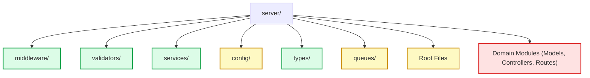
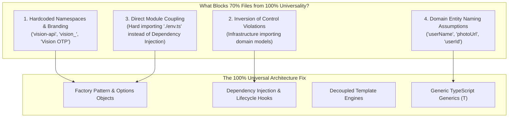

# Vision — Master Universal Files & Infrastructure Architecture Catalog

This master document indexes and analyzes all **universal** (domain-agnostic, generic infrastructure, middleware, utilities, types, and configurations) files across both the **server** and **client** areas of the project.

In backend software engineering, **Universal Code** refers to domain-agnostic, generic infrastructure, middleware, utilities, and typing that contain zero business logic or domain-specific entity names. Such files can be copied into **any** other Node.js/Express backend (e.g., an e-commerce platform, chat application, or microservice) and function immediately without modification.

---

## 1. 🏆 Master List: 100% Fully Universal Files (Plug-and-Play)

These **8 files** are completely domain-agnostic, zero-dependency on Vision models, and 100% reusable across any Node.js project:

| # | File Name | File Path | Category | Why It Is 100% Fully Universal |
|:---:|:---|:---|:---|:---|
| 1 | [`validate.ts`](file:///Users/kunalyadav/Documents/Projects/vision/server/validators/validate.ts) | `server/validators/validate.ts` | Validation Middleware | Generates Express middleware for `req.body`, `req.query`, and `req.params` from any arbitrary Zod schema; standardizes HTTP 400 error payloads. |
| 2 | [`cache.service.ts`](file:///Users/kunalyadav/Documents/Projects/vision/server/services/cache.service.ts) | `server/services/cache.service.ts` | Caching Service | Production-ready Redis cache-aside wrapper (`getOrSetCache`) with stampede-prevention jitter (+/-15%), penetration guards, pattern invalidation (`SCAN` + `DEL`), and fail-open resilience. |
| 3 | [`transaction.service.ts`](file:///Users/kunalyadav/Documents/Projects/vision/server/services/transaction.service.ts) | `server/services/transaction.service.ts` | Database Service | Generic MongoDB multi-document ACID transaction orchestrator (`withTransaction`) that automatically handles session lifecycle, commit/abort, and non-replica-set standalone fallbacks. |
| 4 | [`slidingRateLimit.ts`](file:///Users/kunalyadav/Documents/Projects/vision/server/middleware/slidingRateLimit.ts) | `server/middleware/slidingRateLimit.ts` | Security Middleware | Distributed sliding-window rate limiter powered by Redis Sorted Sets (ZSET); calculates atomic window limits, sets standard rate limit headers, and fails open if Redis goes offline. |
| 5 | [`multer.ts`](file:///Users/kunalyadav/Documents/Projects/vision/server/middleware/multer.ts) | `server/middleware/multer.ts` | Upload Middleware | General-purpose multipart file uploader with disk storage, auto-directory creation (`recursive: true`), and standard image/video MIME type filtering. |
| 6 | [`express.d.ts`](file:///Users/kunalyadav/Documents/Projects/vision/server/types/express.d.ts) | `server/types/express.d.ts` | TypeScript Ambient Typing | Global ambient declaration augmenting `Express.Request` with `id?: string` for correlation tracking and user identification. |
| 7 | [`tsconfig.json`](file:///Users/kunalyadav/Documents/Projects/vision/server/tsconfig.json) | `server/tsconfig.json` | Tooling Configuration | Strict NodeNext ES2022 TypeScript compiler configuration with ESM interop, path exclusions, and type roots. |
| 8 | [`schemas.ts` (Core Blocks)](file:///Users/kunalyadav/Documents/Projects/vision/server/validators/schemas.ts#L4-L16) | `server/validators/schemas.ts` | Validation Schemas | Contains [`objectIdSchema`](file:///Users/kunalyadav/Documents/Projects/vision/server/validators/schemas.ts#L4) (validates any 24-char hex MongoDB ObjectId) and [`paginationQuerySchema`](file:///Users/kunalyadav/Documents/Projects/vision/server/validators/schemas.ts#L9) (clamps limit 1–50 and parses cursor). |

---

## 2. 📂 Folder-Wise Universality Analysis



### 🛡️ `server/middleware/`

| File | Universality Score | Status | Technical Rationale |
|:---|:---:|:---:|:---|
| [`slidingRateLimit.ts`](file:///Users/kunalyadav/Documents/Projects/vision/server/middleware/slidingRateLimit.ts) | **100%** | **Fully Universal** | Completely decoupled from application business logic. Takes arbitrary `windowMs`, `maxRequests`, and key generator; executes atomic Redis ZSET transactions. |
| [`multer.ts`](file:///Users/kunalyadav/Documents/Projects/vision/server/middleware/multer.ts) | **100%** | **Fully Universal** | Accepts any standard image or video format (JPEG, PNG, WebP, MP4, WebM, MKV). Reusable across any media/content application. |
| [`isAuthenticated.ts`](file:///Users/kunalyadav/Documents/Projects/vision/server/middleware/isAuthenticated.ts) | **95%** | **Near Universal** | Extracts Bearer headers or cookies, verifies against `SECRET_KEY`, and decorates `req.id`. Only requires a token payload containing a user identifier. |
| [`rateLimit.ts`](file:///Users/kunalyadav/Documents/Projects/vision/server/middleware/rateLimit.ts) | **65%** | **Semi-Universal** | Imports `slidingRateLimit` and configures specific endpoint window limits (`authLimiter`, `otpLimiter`, `apiLimiter`). The configuration is project-tuned, but the pattern is reusable. |

---

### ⚙️ `server/validators/`

| File | Universality Score | Status | Technical Rationale |
|:---|:---:|:---:|:---|
| [`validate.ts`](file:///Users/kunalyadav/Documents/Projects/vision/server/validators/validate.ts) | **100%** | **Fully Universal** | Consumes any Zod schema (`ZodTypeAny`) and outputs an Express middleware for `body`, `query`, or `params`. Zero domain logic. |
| [`schemas.ts`](file:///Users/kunalyadav/Documents/Projects/vision/server/validators/schemas.ts) | **40%** | **Hybrid / Split** | Lines 4–16 ([`objectIdSchema`](file:///Users/kunalyadav/Documents/Projects/vision/server/validators/schemas.ts#L4), [`paginationQuerySchema`](file:///Users/kunalyadav/Documents/Projects/vision/server/validators/schemas.ts#L9)) are **100% Universal**. Lines 18–125 (e.g., `createVideoSchema`, `createChannelSchema`, `createPostSchema`) are Vision-domain specific. |
| [`authValidators.ts`](file:///Users/kunalyadav/Documents/Projects/vision/server/validators/authValidators.ts) | **75%** | **Semi-Universal** | Standard authentication schemas (`emailSchema`, `passwordSchema`, `usernameSchema`, `loginSchema`, `signupSchema`). Reusable in any project implementing email/password auth. |

---

### 🔧 `server/services/`

| File | Universality Score | Status | Technical Rationale |
|:---|:---:|:---:|:---|
| [`cache.service.ts`](file:///Users/kunalyadav/Documents/Projects/vision/server/services/cache.service.ts) | **100%** | **Fully Universal** | Pure distributed caching abstraction. Includes stampede prevention jitter, null-caching for penetration protection, and non-blocking `SCAN` pattern invalidation. |
| [`transaction.service.ts`](file:///Users/kunalyadav/Documents/Projects/vision/server/services/transaction.service.ts) | **100%** | **Fully Universal** | Multi-document ACID transaction orchestrator. Automatically handles MongoDB connection state, snapshot read concern, majority write concern, and standalone fallbacks. |
| [`logger.service.ts`](file:///Users/kunalyadav/Documents/Projects/vision/server/services/logger.service.ts) | **95%** | **Near Universal** | Standard Pino logger configuration with ISO timestamps and level formatting. Only includes a minor domain label (`service: "vision-api"`). |
| [`metrics.service.ts`](file:///Users/kunalyadav/Documents/Projects/vision/server/services/metrics.service.ts) | **90%** | **Near Universal** | Standard Prometheus RED telemetry (Rate, Errors, Duration) histogram, active in-flight request gauge, and `/metrics` exporter. Only project label is the metric prefix (`vision_`). |
| [`viewBuffer.service.ts`](file:///Users/kunalyadav/Documents/Projects/vision/server/services/viewBuffer.service.ts) | **50%** | **Semi-Universal** | The HyperLogLog deduplication pattern + Redis hash view buffer + bulk write flush is an elite engineering pattern, but it directly queries the [`Video`](file:///Users/kunalyadav/Documents/Projects/vision/server/models/video.Model.ts) model. |

---

### 🔌 `server/config/`

| File | Universality Score | Status | Technical Rationale |
|:---|:---:|:---:|:---|
| [`cloudinary.ts`](file:///Users/kunalyadav/Documents/Projects/vision/server/config/cloudinary.ts) | **95%** | **Near Universal** | Generic Cloudinary asset uploader with automated local disk unlink, 2-minute upload timeout, and hermetic CI test mocking. Zero business logic. |
| [`db.ts`](file:///Users/kunalyadav/Documents/Projects/vision/server/config/db.ts) | **75%** | **Semi-Universal** | Standard Mongoose connection lifecycle manager with 5s timeout and native NoSQL injection protection (`sanitizeFilter: true`). Calls domain index builder. |
| [`sendMail.ts`](file:///Users/kunalyadav/Documents/Projects/vision/server/config/sendMail.ts) | **65%** | **Semi-Universal** | Generic Nodemailer SMTP configuration and OTP email generator. Template has Vision branding. |
| [`env.ts`](file:///Users/kunalyadav/Documents/Projects/vision/server/config/env.ts) | **60%** | **Semi-Universal** | Type-safe environment validation via Zod with alias normalization. Key names (`MONGO_URI`, `PORT`, `REDIS_URL`) are standard, but Cloudinary/SMTP variables are tailored. |
| [`indexes.ts`](file:///Users/kunalyadav/Documents/Projects/vision/server/config/indexes.ts) | **10%** | **Domain-Specific** | Explicitly builds compound and full-text indexes for Vision collections (`Video`, `Short`, `Channel`, `User`, `Comment`). |

---

### 🏷️ `server/types/`

| File | Universality Score | Status | Technical Rationale |
|:---|:---:|:---:|:---|
| [`express.d.ts`](file:///Users/kunalyadav/Documents/Projects/vision/server/types/express.d.ts) | **100%** | **Fully Universal** | Extends Express native `Request` with `id?: string`. Works in any Express project. |
| [`env.d.ts`](file:///Users/kunalyadav/Documents/Projects/vision/server/types/env.d.ts) | **70%** | **Semi-Universal** | Ambient typing declaration for Node's `ProcessEnv`. Structural declaration is universal; listed environment keys are project-specific. |

---

### 📬 `server/queues/`

| File | Universality Score | Status | Technical Rationale |
|:---|:---:|:---:|:---|
| [`videoQueue.ts`](file:///Users/kunalyadav/Documents/Projects/vision/server/queues/videoQueue.ts) | **40%** | **Semi-Universal** | BullMQ lazy Queue and Worker initialization with exponential backoff and Redis connection is a universal pattern, but the job data and resolution transcoding is specific to video streaming. |

---

### 🚀 Root Files & Entrypoint

| File | Universality Score | Status | Technical Rationale |
|:---|:---:|:---:|:---|
| [`tsconfig.json`](file:///Users/kunalyadav/Documents/Projects/vision/server/tsconfig.json) | **100%** | **Fully Universal** | Modern NodeNext / ES2022 TypeScript configuration applicable to any Node.js backend. |
| [`Dockerfile`](file:///Users/kunalyadav/Documents/Projects/vision/server/Dockerfile) | **85%** | **Near Universal** | Standard Alpine multi-stage Docker build for Node.js apps with non-root security user (`USER node`). |
| [`index.ts`](file:///Users/kunalyadav/Documents/Projects/vision/server/index.ts) | **35%** | **Semi-Universal** | The middleware orchestration pipeline (Helmet, request correlation, Prometheus metrics, CORS, body limits, centralized error handler) is universal infrastructure, but it mounts Vision routers (`/auth`, `/user`, `/content`). |

---

### 📦 Domain Collections: `models/`, `controllers/`, and `routes/`

All files in these directories are **Domain-Coupled (0% – 20% Universal)**:
- **Models** ([`video.Model.ts`](file:///Users/kunalyadav/Documents/Projects/vision/server/models/video.Model.ts), [`short.Model.ts`](file:///Users/kunalyadav/Documents/Projects/vision/server/models/short.Model.ts), [`user.Model.ts`](file:///Users/kunalyadav/Documents/Projects/vision/server/models/user.Model.ts), [`channel.Model.ts`](file:///Users/kunalyadav/Documents/Projects/vision/server/models/channel.Model.ts), [`playlist.Model.ts`](file:///Users/kunalyadav/Documents/Projects/vision/server/models/playlist.Model.ts), [`post.Model.ts`](file:///Users/kunalyadav/Documents/Projects/vision/server/models/post.Model.ts)): Specific MongoDB entity definitions. *(Exception: [`comment.Model.ts`](file:///Users/kunalyadav/Documents/Projects/vision/server/models/comment.Model.ts) has a 40% universal polymorphic comment/reply pattern).*
- **Controllers** ([`video.Controller.ts`](file:///Users/kunalyadav/Documents/Projects/vision/server/controllers/video.Controller.ts), [`short.Controller.ts`](file:///Users/kunalyadav/Documents/Projects/vision/server/controllers/short.Controller.ts), [`playlist.Controller.ts`](file:///Users/kunalyadav/Documents/Projects/vision/server/controllers/playlist.Controller.ts), [`user.controller.ts`](file:///Users/kunalyadav/Documents/Projects/vision/server/controllers/user.controller.ts), [`auth.Controller.ts`](file:///Users/kunalyadav/Documents/Projects/vision/server/controllers/auth.Controller.ts)): Pure business logic.
- **Routes** ([`user.Routes.ts`](file:///Users/kunalyadav/Documents/Projects/vision/server/routes/user.Routes.ts), [`content.Routes.ts`](file:///Users/kunalyadav/Documents/Projects/vision/server/routes/content.Routes.ts), [`auth.Routes.ts`](file:///Users/kunalyadav/Documents/Projects/vision/server/routes/auth.Routes.ts)): Specific REST endpoint bindings.

---

## 3. 🔬 Anatomy of Semi-Universal Code (70% → 100% Universality)

To understand what separates a **70%–95% Universal** file from a **100% Universal** file, we examine the **Dependency Inversion Principle (DIP)**:

> *"High-level modules should not depend on low-level modules; both should depend on abstractions. Reusable infrastructure should never know the name of the project it is running inside."*

---

### 🛑 The 4 Core Blockers Preventing 100% Universality



---

### 📋 File-by-File Technical Deep Dive

Below is the exhaustive breakdown of each file scoring 40% to 95%, explaining what blocks it, how and why it prevents universality, and the concrete code transformation required to make it 100% universal.

---

#### 1. [`logger.service.ts`](file:///Users/kunalyadav/Documents/Projects/vision/server/services/logger.service.ts)
- **Current Score**: **95%**
- **What Prevents 100%**:
  1. Direct hardcoded string: `service: "vision-api"`.
  2. Direct import of `./config/env.ts` (`import env from "../config/env.ts"`).
- **How & Why**:
  If this file is copied into an e-commerce, authentication, or billing microservice, every structured JSON log line in Datadog/CloudWatch will falsely report `service: "vision-api"`. Furthermore, it cannot be compiled in a project where `../config/env.ts` does not exist at that exact relative path.
- **The Transformation (To 100% Universal)**:
  Use an environment fallback and an optional factory function:
  ```typescript
  // 100% Universal: Reads from generic process.env or accepts factory config
  export const createLogger = (serviceName = process.env.SERVICE_NAME || "api-service") =>
    pino({
      level: process.env.NODE_ENV === "production" ? "info" : "debug",
      timestamp: pino.stdTimeFunctions.isoTime,
      base: { service: serviceName, env: process.env.NODE_ENV || "development" },
    });

  export const logger = createLogger();
  export default logger;
  ```

---

#### 2. [`metrics.service.ts`](file:///Users/kunalyadav/Documents/Projects/vision/server/services/metrics.service.ts)
- **Current Score**: **90%**
- **What Prevents 100%**:
  1. Hardcoded metric prefix: `prefix: "vision_"`.
  2. Hardcoded metric names: `"vision_http_requests_total"`, `"vision_http_request_duration_seconds"`, `"vision_active_requests"`.
- **How & Why**:
  When Prometheus scrapes multiple microservices using this file, all metrics will share the `vision_` namespace. Time-series databases will either suffer key collisions or merge telemetry from unrelated services.
- **The Transformation (To 100% Universal)**:
  Expose a factory accepting a prefix:
  ```typescript
  // 100% Universal Prometheus RED Factory
  export const createMetrics = (prefix = process.env.METRICS_PREFIX || "app_") => {
    const register = new client.Registry();
    client.collectDefaultMetrics({ register, prefix });

    const httpRequestCounter = new client.Counter({
      name: `${prefix}http_requests_total`,
      help: "Total HTTP requests",
      labelNames: ["method", "route", "status_code"],
      registers: [register],
    });
    // ...
    return { register, httpRequestCounter, /* middleware */ };
  };
  ```

---

#### 3. [`cloudinary.ts`](file:///Users/kunalyadav/Documents/Projects/vision/server/config/cloudinary.ts)
- **Current Score**: **95%**
- **What Prevents 100%**:
  1. Hard dependency on [`server/config/env.ts`](file:///Users/kunalyadav/Documents/Projects/vision/server/config/env.ts).
  2. Tightly coupled to Cloudinary SDK singleton (`cloudinary.config({...})`).
- **How & Why**:
  The file cannot be packaged into a shared npm utility because it directly imports a local project file (`./env.ts`). If a team decides to switch from Cloudinary to AWS S3, Cloudflare R2, or Google Cloud Storage, the entire module must be rewritten.
- **The Transformation (To 100% Universal)**:
  Decouple via an options argument or Storage Provider interface:
  ```typescript
  export interface StorageUploader {
    upload: (filePath: string) => Promise<string | undefined>;
  }

  export const createCloudinaryUploader = (credentials?: {
    cloud_name?: string;
    api_key?: string;
    api_secret?: string;
  }): StorageUploader => {
    // Uses passed credentials or falls back to standard process.env
    cloudinary.config(credentials || {
      cloud_name: process.env.CLOUDINARY_CLOUD_NAME,
      api_key: process.env.CLOUDINARY_API_KEY,
      api_secret: process.env.CLOUDINARY_API_SECRET,
    });

    return {
      upload: async (filePath: string) => { /* generic upload & unlink */ }
    };
  };
  ```

---

#### 4. [`isAuthenticated.ts`](file:///Users/kunalyadav/Documents/Projects/vision/server/middleware/isAuthenticated.ts)
- **Current Score**: **95%**
- **What Prevents 100%**:
  1. Hardcoded interface: `interface VisionJwtPayload { userId: string }`.
  2. Hardcoded secret reference: `process.env.SECRET_KEY!`.
  3. Hardcoded cookie name: `req.cookies?.token`.
- **How & Why**:
  Standard JWTs (RFC 7519) store the user subject under `sub` rather than `userId`. Other backends name their session cookie `"jwt"`, `"session"`, or `"access_token"`, and read secrets from `JWT_SECRET`.
- **The Transformation (To 100% Universal)**:
  Make the authentication middleware a configurable factory:
  ```typescript
  // 100% Universal Auth Guard Factory
  export const createAuthGuard = <T = { userId: string }>(options?: {
    secretKey?: string;
    cookieName?: string;
    extractPayload?: (decoded: unknown) => string | undefined;
  }) => {
    const secret = options?.secretKey || process.env.JWT_SECRET || process.env.SECRET_KEY!;
    const cookieName = options?.cookieName || "token";

    return (req: Request, res: Response, next: NextFunction) => {
      const token = req.cookies?.[cookieName] || req.headers.authorization?.slice(7);
      if (!token) return res.status(401).json({ message: "Unauthenticated" });
      
      const decoded = jwt.verify(token, secret) as any;
      req.id = options?.extractPayload ? options.extractPayload(decoded) : (decoded.userId || decoded.sub);
      next();
    };
  };
  ```

---

#### 5. [`db.ts`](file:///Users/kunalyadav/Documents/Projects/vision/server/config/db.ts)
- **Current Score**: **75%**
- **What Prevents 100%**:
  1. Direct hardcoded import: `import { ensureDatabaseIndexes } from "./indexes.ts"`.
  2. Execution of `await ensureDatabaseIndexes()` inside `connectDb()`.
- **How & Why**:
  This is an **Inversion of Control** violation. A generic database connection manager should only manage socket connections, timeouts, and connection pools. Because it imports `indexes.ts`, which in turn imports `Video`, `Short`, `Channel`, and `User` models, `db.ts` cannot connect to MongoDB without dragging in the entire domain data layer.
- **The Transformation (To 100% Universal)**:
  Remove domain index building or inject it via an optional lifecycle callback:
  ```typescript
  // 100% Universal DB Manager
  export const connectDb = async (options?: {
    mongoUri?: string;
    onConnected?: () => Promise<void>;
  }): Promise<boolean> => {
    const uri = options?.mongoUri || process.env.MONGO_URI;
    if (!uri) return false;

    await mongoose.connect(uri, { serverSelectionTimeoutMS: 5000 });
    if (options?.onConnected) {
      await options.onConnected(); // Injects domain indexes without coupling
    }
    return true;
  };
  ```

---

#### 6. [`sendMail.ts`](file:///Users/kunalyadav/Documents/Projects/vision/server/config/sendMail.ts)
- **Current Score**: **65%**
- **What Prevents 100%**:
  1. Hardcoded provider: `service: "Gmail"`.
  2. Hardcoded company branding: `from: '"Vision"'`, `subject: "Reset Your Vision Password"`, `#ef4444` Vision red accents.
  3. Fixed OTP message body.
- **How & Why**:
  The email transport layer is tightly coupled to one specific transactional message (Vision password reset). It cannot send a welcome email, billing invoice, or notification.
- **The Transformation (To 100% Universal)**:
  Split into a **Generic Email Dispatcher** (100% Universal) and a **Template Function**:
  ```typescript
  // 1. 100% Universal Mailer Service
  export interface EmailMessage {
    to: string;
    subject: string;
    html: string;
    from?: string;
  }

  export const sendEmail = async (message: EmailMessage) => {
    const transporter = nodemailer.createTransport({
      host: process.env.SMTP_HOST || "smtp.gmail.com",
      port: Number(process.env.SMTP_PORT) || 465,
      auth: { user: process.env.EMAIL_USER, pass: process.env.EMAIL_PASS },
    });
    return transporter.sendMail(message);
  };

  // 2. Project-Specific Template (Kept in domain layer)
  export const sendOtpEmail = (to: string, otp: string) =>
    sendEmail({
      to,
      subject: "Your OTP Code",
      html: renderOtpTemplate(otp),
    });
  ```

---

#### 7. [`viewBuffer.service.ts`](file:///Users/kunalyadav/Documents/Projects/vision/server/services/viewBuffer.service.ts)
- **Current Score**: **50%**
- **What Prevents 100%**:
  1. Hardcoded import: `import { Video } from "../models/video.Model.ts"`.
  2. Hardcoded Redis keys: `"vision:views:buffer"`, `"vision:views:hll:${videoId}"`.
  3. Hardcoded database write: `Video.bulkWrite(...)`.
- **How & Why**:
  The core algorithm (using Redis HyperLogLog `pfAdd` for 24h viewer deduplication, storing counts in a Redis hash, and atomically swapping the buffer key using `RENAME` during `bulkWrite`) is a **world-class distributed system pattern**. However, because it directly mutates `Video.bulkWrite`, it cannot be reused for counting post reads, article views, or song plays.
- **The Transformation (To 100% Universal)**:
  Extract into a generic `BufferedCounter`:
  ```typescript
  // 100% Universal HyperLogLog Buffered Aggregator
  export class HyperLogLogCounter<TId extends string = string> {
    constructor(
      private redisKeyPrefix: string,
      private flushTarget: (counts: Record<TId, number>) => Promise<void>
    ) {}

    async recordUniqueEvent(entityId: TId, visitorId: string): Promise<boolean> {
      // HLL pfAdd + HINCRBY
    }

    async flush(): Promise<void> {
      // Atomic RENAME -> HGETALL -> flushTarget()
    }
  }
  ```

---

#### 8. [`videoQueue.ts`](file:///Users/kunalyadav/Documents/Projects/vision/server/queues/videoQueue.ts)
- **Current Score**: **40%**
- **What Prevents 100%**:
  1. Hardcoded domain interface: `TranscodeJobData` (`videoId`, `resolutions`, `channelId`).
  2. Direct database coupling: `Video.findByIdAndUpdate(...)`.
  3. Hardcoded queue name: `"video-transcoding"`.
- **How & Why**:
  The queue setup logic (lazy BullMQ initialization, connection parsing from URL, exponential backoff with 3 attempts and 5s delay, concurrency controls, test bypass) is generic. However, the worker execution logic is completely bound to video transcoding and the `Video` model.
- **The Transformation (To 100% Universal)**:
  Decouple the Queue Factory from the Job Processor:
  ```typescript
  // 100% Universal Queue Factory
  export const createWorkerQueue = <TData>(
    queueName: string,
    processor: (job: Job<TData>) => Promise<any>,
    options?: { concurrency?: number; attempts?: number }
  ) => {
    const queue = new Queue<TData>(queueName, { connection: getRedisConnection() });
    const worker = new Worker<TData>(queueName, processor, {
      connection: getRedisConnection(),
      concurrency: options?.concurrency || 2,
    });
    return { queue, worker };
  };
  ```

---

### 📊 Summary Comparison: 70% vs. 100% Universal Code

| Feature / Aspect | 70%–85% Universal (Current State) | 100% Universal (Target Architecture) |
|:---|:---|:---|
| **Configuration** | Imports `./config/env.ts` directly | Accepts options object; falls back to standard `process.env` |
| **Project Identity** | Hardcoded strings (`"vision-api"`, `"vision_"`) | Parameterized variables (`process.env.SERVICE_NAME`) |
| **Model Coupling** | Directly imports Mongoose models (`Video`, `User`) | Uses Dependency Injection, generic callbacks, or interfaces |
| **Token Claims** | Assumes `userId` property on payload | Accepts custom extractor or uses RFC 7519 standard `sub` |
| **Portability** | Requires specific Vision folder structure | Can be published to npm or copied to any TypeScript project |

---

## 4. 💻 Client Area Universal Files ([`client/universal.md`](file:///Users/kunalyadav/Documents/Projects/vision/client/universal.md))

| File Name | Relative Path | Absolute Path | Purpose / Category |
|---|---|---|---|
| [`Loader.tsx`](file:///Users/kunalyadav/Documents/Projects/vision/client/src/components/Loader.tsx) | `client/src/components/Loader.tsx` | `/Users/kunalyadav/Documents/Projects/vision/client/src/components/Loader.tsx` | Pure Tailwind animated loading spinner component |
| [`constants.ts`](file:///Users/kunalyadav/Documents/Projects/vision/client/src/constants.ts) | `client/src/constants.ts` | `/Users/kunalyadav/Documents/Projects/vision/client/src/constants.ts` | Frontend environment constants (`serverUrl` with fallback logic) |
| [`firebase.ts`](file:///Users/kunalyadav/Documents/Projects/vision/client/src/utils/firebase.ts) | `client/src/utils/firebase.ts` | `/Users/kunalyadav/Documents/Projects/vision/client/src/utils/firebase.ts` | Firebase Client App, Google Auth Provider, and Analytics instance |
| [`store.ts`](file:///Users/kunalyadav/Documents/Projects/vision/client/src/redux/store.ts) | `client/src/redux/store.ts` | `/Users/kunalyadav/Documents/Projects/vision/client/src/redux/store.ts` | Central Redux Toolkit store and exported `RootState` & `AppDispatch` types |
| [`index.ts`](file:///Users/kunalyadav/Documents/Projects/vision/client/src/types/index.ts) | `client/src/types/index.ts` | `/Users/kunalyadav/Documents/Projects/vision/client/src/types/index.ts` | Central shared TypeScript interfaces across the frontend |
| [`vite-env.d.ts`](file:///Users/kunalyadav/Documents/Projects/vision/client/src/vite-env.d.ts) | `client/src/vite-env.d.ts` | `/Users/kunalyadav/Documents/Projects/vision/client/src/vite-env.d.ts` | Ambient Vite environment and asset typing shims |

---

## 5. 📊 Codebase Universality Summary & Metrics

| Tier Level | Universality Range | File Count | Percentage of Server | Primary Examples |
|:---:|:---:|:---:|:---:|:---|
| 🟢 **Tier 1** | **100% Fully Universal** | **8 files** | **23%** | `validate.ts`, `cache.service.ts`, `transaction.service.ts`, `slidingRateLimit.ts`, `multer.ts` |
| 🟡 **Tier 2** | **50% – 95% Semi-Universal** | **12 files** | **34%** | `logger.service.ts`, `metrics.service.ts`, `cloudinary.ts`, `isAuthenticated.ts`, `db.ts`, `sendMail.ts` |
| 🔴 **Tier 3** | **0% – 20% Domain-Coupled** | **15 files** | **43%** | Models (`Video`, `User`), Controllers (`video.Controller`, `auth.Controller`), Routes |

---

## 📂 Dedicated Area References
For further in-depth module exports and architectural implementation details:
- 🖥️ **Server Universal Catalog**: [`server/universal.md`](file:///Users/kunalyadav/Documents/Projects/vision/server/universal.md)
- 💻 **Client Universal Catalog**: [`client/universal.md`](file:///Users/kunalyadav/Documents/Projects/vision/client/universal.md)
